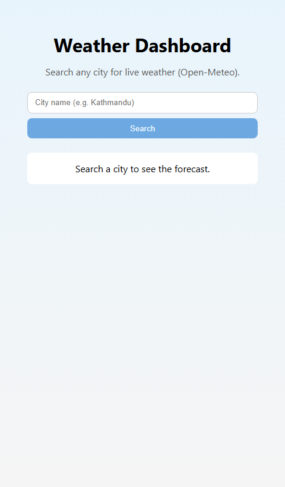
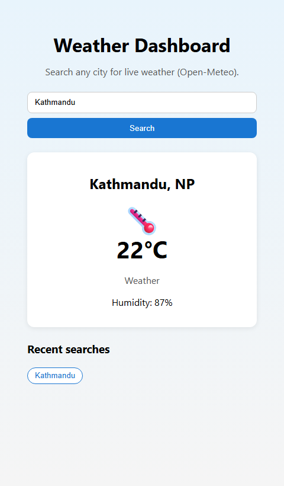
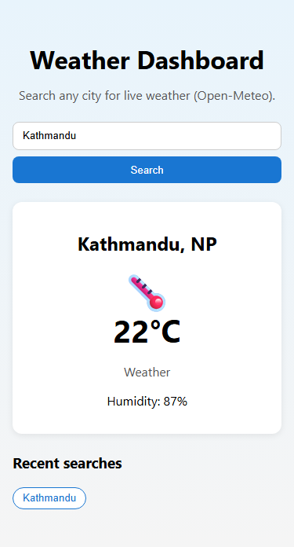

# Weather Dashboard

A simple React app that searches cities and shows live weather from the free [Open-Meteo](https://open-meteo.com/) public API (no API key required). Includes loading/error states and recent search history in localStorage.

## Features

- Search weather by city name
- Temperature, condition, humidity, and weather icon
- Loading and error messages
- Last 5 searches (localStorage)

## Setup

1. `npm install`
2. `npm run dev`

No `.env` file is needed.

## Tech

- React (Vite), `useState`, `useEffect`, fetch API

## Screenshots

**Home (before search)**

**Weather result (Kathmandu)**

**Mobile layout**

## Notes

- Assignment allows any public weather API; this project uses Open-Meteo because it is free and keyless.
